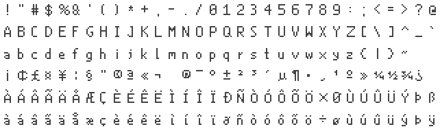
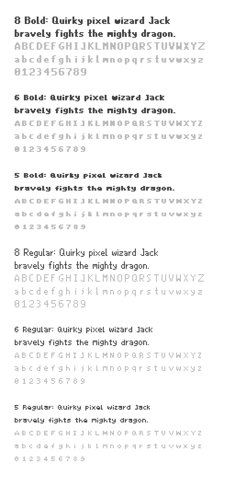
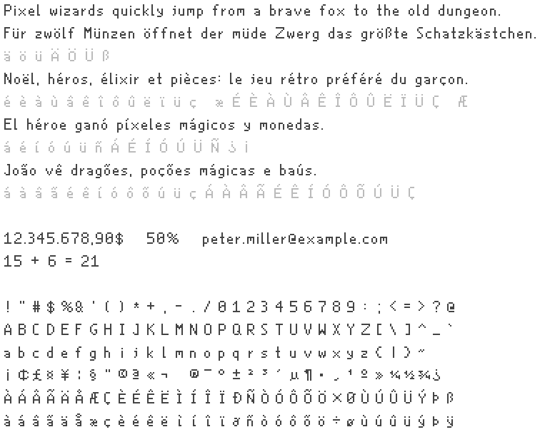

# Carl Font Project

Carl Font is a compact handcrafted pixel typeface made for pixel games and other projects where screen space is limited.
I created this font for one of my projects and am sharing it in the hope that it will be useful. You can use it for commercial projects as well. See the [license section](#license) below.

(Example showing an 8-pixel character height in regular style)

The font is primary made for games but also works for the web. Check out the [HTML Demo](https://philipp-schwarz.github.io/dist/carlfont/demo.html).

## Styles and sizes

The font is available in three sizes: 5, 6, and 8 pixels. The size refers to the height of uppercase letters. Lowercase letters are smaller. Accented characters and similar marks may extend above the cap height, while letters such as `q` and `g` may descend below the baseline.

Each size is available in **Regular** and **Bold**. The TTF version also includes a **Pad** style (short for padding), which adds one pixel of space between letters.
The **Monospace** version is still a work in progress and will be available soon.

## Usage and installation

**Windows / Linux / macOS / Web**

You can find the TTF files in `font/ttf/`.

**Any game engine**

Refer to your engine's documentation. In general:

- Import PNG files from `font/`.
- Set the character grid to 16 × 16 pixels.

**Draw16**

Import the PNG or JavaScript files. Both work out of the box.

## Preview

You can also open [`demo.html`](demo.html) in a browser to see the fonts in action.

## Character set

The fonts include visible characters in the Unicode range U+0000–U+00FF (the first 256 Unicode code points, commonly known as Latin-1). This includes basic Latin characters, digits, punctuation, and accented characters.

## License

Carl Font is released under the **SIL Open Font License, Version 1.1**. Commercial use, modification, redistribution, and embedding in software and documents are permitted under the terms of that license.

If the license does not fit your use case, please contact me. I would really like this font to be used.

## AI note

This pixel font is handcrafted, character by character and pixel by pixel. No AI was used to create the font itself.

AI was used to help create the documentation and distribution scripts. Using AI seemed like a sensible choice for this work.

## Complex example and character overview

